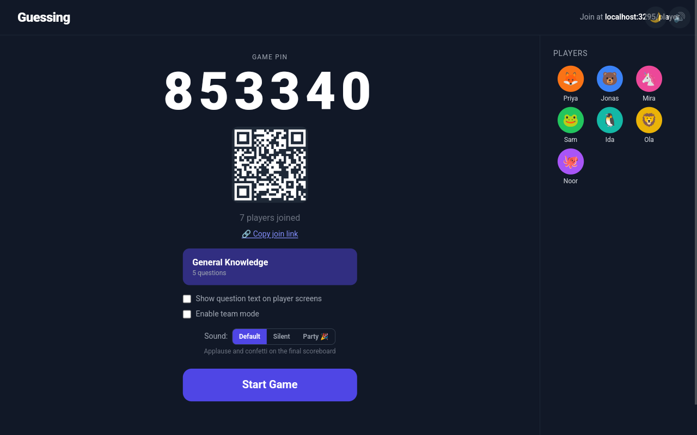
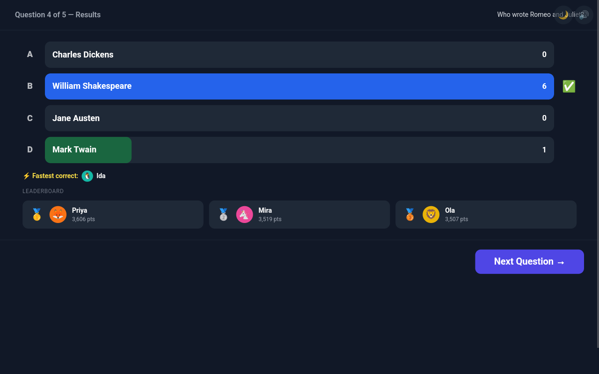
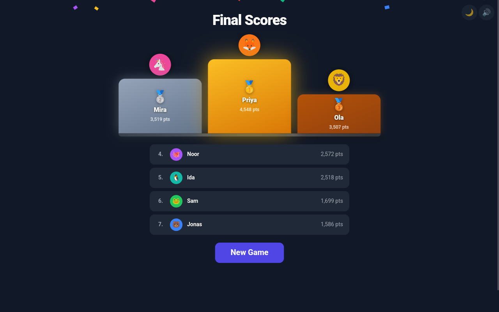
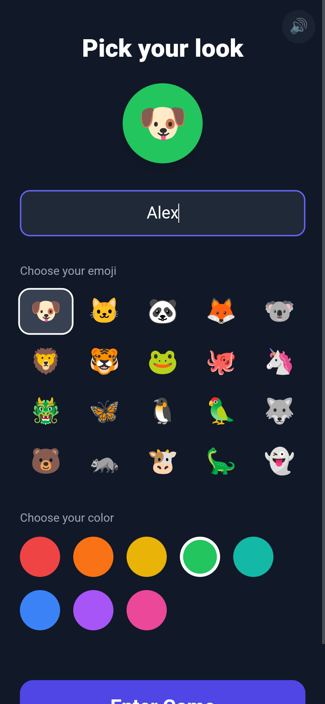
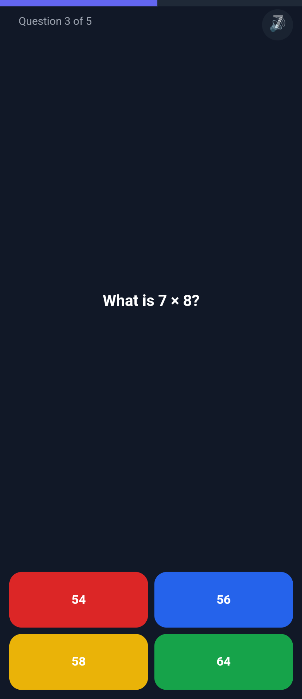
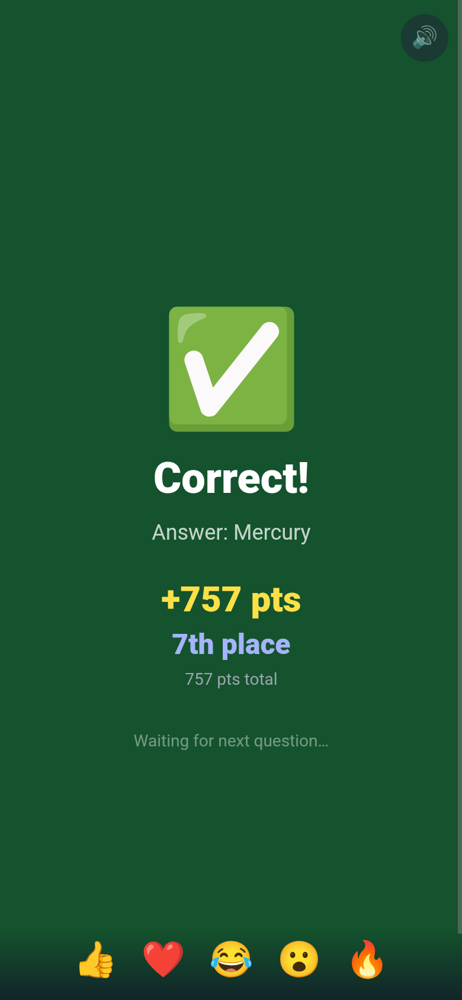

# Guessing
A multiplayer self hosted Quiz

<table>
  <tr>
    <td align="center"></td>
    <td align="center"></td>
  </tr>
  <tr>
    <td align="center">Host lobby</td>
    <td align="center">Question results</td>
  </tr>
  <tr>
    <td align="center" colspan="2"> Final podium</td>
  </tr>
</table>

<table>
  <tr>
    <td align="center"></td>
    <td align="center"></td>
    <td align="center"></td>
  </tr>
  <tr>
    <td align="center">Pick your look</td>
    <td align="center">Answering on a phone</td>
    <td align="center">Correct answer</td>
  </tr>
</table>

Screenshots: Guessing 0.1.0 (commit <code>1af72e1</code>), taken 28 October 2026 with the bundled General Knowledge quiz and sample players.
